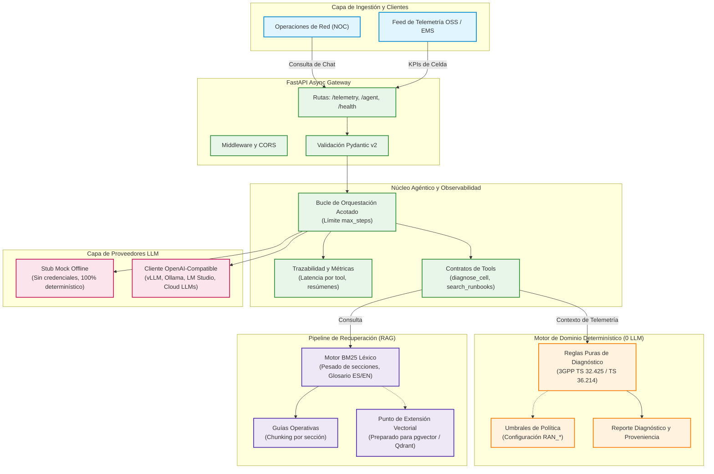
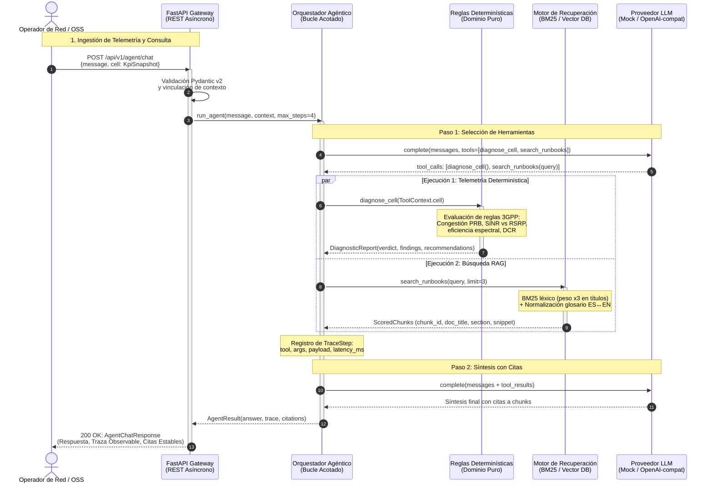

# HACOM AI Telco Engine

[English](README.md) | **Español**

Prueba de concepto de IA Aplicada para operaciones de redes móviles: núcleo determinístico de diagnóstico de KPIs RAN expuesto como servicio, con un bucle de orquestación de agentes y recuperación de guías operativas (RAG) en la capa superior.

> Proyecto de demostración independiente. No afiliado, respaldado ni patrocinado por HACOM Technologies.

---

## Por qué existe

La mayoría de las demostraciones de "IA para telecomunicaciones" colocan un modelo de lenguaje en el centro de todo y producen texto persuasivo que nadie puede auditar. Un equipo de operaciones de red (NOC / SOC) no puede actuar sobre eso.

Este proyecto toma la restricción opuesta: **el razonamiento diagnóstico es determinístico y testeable primero**, y el modelo de lenguaje es un consumidor de ese razonamiento, no su reemplazo.

Cuatro consecuencias guían el diseño:

1. **Misma entrada, mismo veredicto.** El motor de reglas está compuesto por funciones puras sobre un snapshot congelado de KPIs. Sin modelo, sin reloj, sin I/O.
2. **El modelo no puede inventar telemetría.** `diagnose_cell` no acepta argumentos. La plataforma adjunta el snapshot de KPIs a la solicitud y la herramienta lo lee directamente del contexto de ejecución. Un modelo que alucina no tiene datos que inventar.
3. **Funciona sin credenciales.** Clonar, `docker compose up` y llamar. El proveedor por defecto es un stub determinístico offline, no un modelo alojado en la nube.
4. **Toda afirmación es trazable.** Cada hallazgo incluye la regla que se activó y los números que la dispararon; las respuestas basadas en RAG incluyen el `chunk_id` exacto de la guía operativa utilizada.

---

## Qué hace hoy

### Diagnóstico determinístico

`POST /api/v1/telemetry/analyze` recibe un snapshot de KPIs de una celda y devuelve un veredicto (`healthy` / `watch` / `degraded` / `critical`), los hallazgos que lo produjeron con su evidencia, recomendaciones dirigidas y la norma 3GPP de la que proviene cada medición.

```json
{
  "cell_id": "LTE-MVD-0421",
  "technology": "LTE",
  "verdict": "degraded",
  "findings": [
    {
      "rule_id": "RADIO_RESOURCE_CONGESTION",
      "severity": "degraded",
      "title": "Radio resource congestion",
      "evidence": { "prb_utilization_dl_pct": 88.0, "capacity_ratio_pct": 11.7 }
    }
  ]
}
```

### Agente con tool calling real

`POST /api/v1/agent/chat` ejecuta un bucle acotado: consulta al proveedor, ejecuta las herramientas solicitadas, retroalimenta los resultados y repite hasta responder o agotar el presupuesto de pasos. La respuesta contiene la síntesis final, **cada paso de la traza de ejecución** y las citas de las guías operativas recuperadas.

Salida real producida por este repositorio:

```
LTE-MVD-0421: DEGRADED. 2 finding(s): Drop call rate above policy target
(HIGH_DROP_CALL_RATE, degraded); Radio resource congestion
(RADIO_RESOURCE_CONGESTION, degraded). Recommended actions: (1) Break the drop reason
codes down (radio, handover, core) before touching radio parameters, so the fix targets
the actual release cause. (2) Sustained PRB saturation with poor delivered efficiency:
enable Mobility Load Balancing, evaluate a second carrier (CA) or small-cell
densification, and review scheduler/QoS weights before adding hardware.

Runbook references: Radio resource congestion > Detection
(radio-resource-congestion#detection); Transport and scheduler efficiency > Detection
(transport-and-scheduler#detection); Radio resource congestion > Symptom
(radio-resource-congestion#symptom).
```

Traza de ejecución correspondiente a esa misma solicitud:

| Paso | Tipo | Herramienta | Resultado |
| --- | --- | --- | --- |
| 1 | `tool_call` | `diagnose_cell` | `degraded: 2 finding(s) [HIGH_DROP_CALL_RATE, RADIO_RESOURCE_CONGESTION]` |
| 1 | `tool_call` | `search_runbooks` | `3 chunk(s): radio-resource-congestion#detection, ...` |
| 2 | `final` | — | la respuesta indicada arriba |

### Catálogo de herramientas

`GET /api/v1/agent/tools` devuelve el mismo esquema JSON que recibe el modelo:

| Herramienta | Argumentos | Función |
| --- | --- | --- |
| `diagnose_cell` | ninguno | Ejecuta el motor de reglas contra el snapshot adjunto por la plataforma. |
| `search_runbooks` | `query`, `limit` (1–5) | Búsqueda BM25 sobre las guías operativas con ids de sección estables. |

### Recuperación RAG con citas

Cuatro guías operativas (`data/runbooks/`) están fragmentadas a nivel de sección, por lo que una cita apunta exactamente a **`coverage-and-interference#interference-limited-branch`**, no a "algún lugar en un PDF". La recuperación utiliza BM25 con un glosario de dominio bilingüe (español ↔ inglés), dado que los operadores consultan en español mientras las normas 3GPP están en inglés.

La calidad de recuperación no se presupone, se mide: `tests/test_retrieval.py` contiene un eval set automatizado con frases reales de operadores asociadas a la sección técnica correspondiente.

---

## Decisiones de diseño clave

Estas son las distinciones técnicas que una implementación genérica suele omitir:

**Alta utilización de PRB no es congestión.**  
Una celda al 92% de PRB entregando 110 Mbps sobre una capacidad base de 120 Mbps está a plena carga y funcionando correctamente. La congestión es agotamiento de recursos *más* degradación en la eficiencia entregada. El motor separa ambos estados y existe una prueba automatizada que lo valida.

**RSRP por sí solo no diagnostica cobertura.**  
Un RSRP débil con SINR negativo es un problema de cobertura. Un RSRP adecuado con SINR deficiente es un problema de interferencia. Mismo síntoma de "mala señal", acciones de remediación opuestas. El motor los distingue combinando ambas mediciones.

**El throughput no tiene sentido sin una referencia de capacidad.**  
5 Mbps es un valor saludable en una portadora de 3 MHz y patológico en una de 100 MHz. La API exige una capacidad base y un ancho de banda para calcular la eficiencia espectral (bits/Hz) y compararla contra referencias de ingeniería.

**Los umbrales son políticas, no estándares.**  
3GPP define cómo se producen y reportan las mediciones, no establece que el 80% de PRB signifique congestión. Todos los umbrales son configurables mediante variables de entorno `RAN_*` y están documentados como políticas del operador.

**Datos inconsistentes generan un hallazgo de calidad, no una excepción.**  
Un throughput reportado por encima de la capacidad base configurada se emite como un hallazgo de calidad de datos en lugar de producir un diagnóstico inválido.

**"Saturado" no es "congestionado".**  
En ingeniería de telecomunicaciones se distingue un enlace de transporte saturado de una interfaz de radio congestionada. El glosario bilingüe mapea ambos conceptos a términos canónicos distintos.

---

## Fuentes de medición

| Métrica | Definida por |
| --- | --- |
| RSRP, RSRQ | 3GPP TS 36.214 (Mediciones de capa física E-UTRA) |
| Utilización de PRB | 3GPP TS 32.425 (E-UTRAN) / TS 28.552 (NR) |
| Throughput | 3GPP TS 32.425 (Mediciones de throughput E-UTRAN) |
| Drop call rate | Derivado de contadores de liberación E-RAB, TS 32.425 |
| SINR | Indicador derivado por vendedor/OSS, no estandarizado en TS 36.214 |

La API retorna este mapeo en cada respuesta (`metric_sources`).

---

## Arquitectura

### Flujo de componentes del sistema



### Diagrama de Secuencia y Señalización Telco

Diagrama de secuencia estilo *call-flow / signaling ladder*:



Para patrones de producción de alta concurrencia (manifests de Kubernetes, escalado HPA, búsqueda vectorial híbrida con `pgvector`/`Qdrant` y trazabilidad con OpenTelemetry/Prometheus), ver la guía de [**Arquitectura de Producción y Cloud**](docs/production-architecture.md).

---

## Configuración

| Variable | Valor por defecto | Propósito |
| --- | --- | --- |
| `LLM_PROVIDER` | `mock` | `mock` (offline, determinístico) o `openai` |
| `LLM_API_KEY` | vacío | Requerido cuando `LLM_PROVIDER=openai` |
| `LLM_BASE_URL` | `https://api.openai.com/v1` | Cualquier endpoint OpenAI-compatible |
| `LLM_MODEL` | `gpt-4o-mini` | Nombre del modelo enviado al proveedor |
| `LLM_MAX_STEPS` | `4` | Límite máximo de iteraciones en el bucle |
| `RAN_*` | ver `.env.example` | Umbrales de política del operador |

---

## Guía de inicio rápido

### Con Docker

```bash
docker compose up --build
```

- API: <http://localhost:8000>
- Documentación interactiva Swagger: <http://localhost:8000/docs>

### Desarrollo Local (con `uv`)

```bash
uv sync
uv run uvicorn app.main:app --reload --port 8000
```

### Consultas de prueba

```bash
# Obtener un payload de prueba
curl -s http://localhost:8000/api/v1/telemetry/sample > cell.json

# Ejecutar el diagnóstico determinístico
curl -s -X POST http://localhost:8000/api/v1/telemetry/analyze \
  -H "Content-Type: application/json" \
  -d @cell.json

# Consultar al agente con telemetría adjunta
cat > chat.json <<'JSON'
{
  "message": "Diagnostico y que dice el runbook de congestion?",
  "cell": {
    "cell_id": "LTE-MVD-0421",
    "technology": "LTE",
    "bandwidth_mhz": 20.0,
    "prb_utilization_dl_pct": 88.0,
    "throughput_dl_mbps": 14.0,
    "cell_capacity_dl_mbps": 120.0,
    "drop_call_rate_pct": 1.8,
    "rsrp_dbm": -98.0,
    "rsrq_db": -14.0,
    "sinr_db": 8.0,
    "active_ues": 214
  }
}
JSON

curl -s -X POST http://localhost:8000/api/v1/agent/chat \
  -H "Content-Type: application/json" \
  -d @chat.json
```

---

## Pruebas automatizadas

```bash
uv run pytest -q     # 62 tests, sin red, sin credenciales
uv run ruff check .
```

---

## Licencia

MIT.
