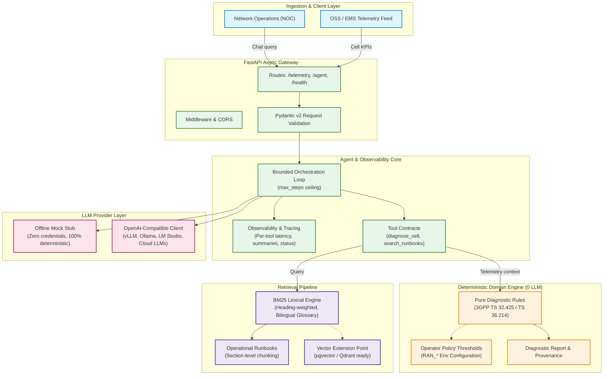
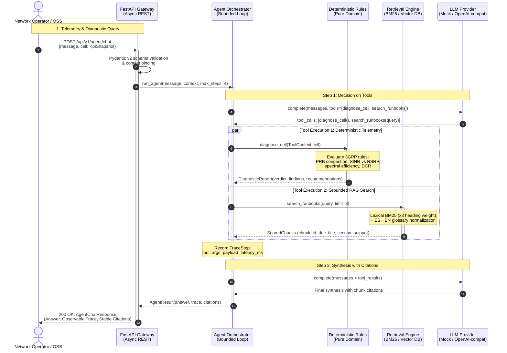

# HACOM AI Telco Engine

**English** | [Español](README.es.md)

Applied-AI proof of concept for mobile network operations: deterministic RAN KPI
diagnostics exposed as a service, with an agent loop and runbook retrieval on top.

> Independent demonstration project. Not affiliated with, endorsed by, or sponsored by
> HACOM Technologies.

---

## Why this exists

Most "AI for telco" demos put a language model in the middle of everything and produce
confident prose that nobody can audit. A network operations team cannot act on that.

This project takes the opposite constraint: **the diagnostic reasoning is deterministic
and testable first**, and the model is a consumer of it, not a replacement for it.

Four consequences drive the design:

1. **Same input, same verdict.** The rule engine is pure functions over a frozen KPI
   snapshot. No model, no clock, no I/O.
2. **The model cannot invent telemetry.** `diagnose_cell` takes no arguments. The
   platform attaches the KPI snapshot to the request and the tool reads it from the
   execution context, so a hallucinating model has nothing to hallucinate with.
3. **It runs with no credentials.** Clone, `docker compose up`, call it. The default
   provider is a deterministic offline stub, not a hosted model.
4. **Every claim is traceable.** Findings carry the rule that fired and the numbers that
   triggered it; runbook answers carry the exact chunk id they used.

---

## What it does today

### Deterministic diagnostics

`POST /api/v1/telemetry/analyze` takes one cell KPI snapshot and returns a verdict
(`healthy` / `watch` / `degraded` / `critical`), the findings that produced it with their
evidence, targeted recommendations, and the standard each measurement comes from.

```json
{
  "cell_id": "LTE-MVD-0421",
  "technology": "LTE",
  "verdict": "degraded",
  "findings": [
    {
      "rule_id": "RADIO_RESOURCE_CONGESTION",
      "severity": "degraded",
      "title": "Radio resource congestion",
      "evidence": { "prb_utilization_dl_pct": 88.0, "capacity_ratio_pct": 11.7 }
    }
  ]
}
```

### Agent with real tool calling

`POST /api/v1/agent/chat` runs a bounded loop: ask the provider, execute whatever tools it
requested, feed the results back, repeat until it answers or the step budget runs out.
The response contains the answer, **every step of the trace**, and the citations that
were actually retrieved.

This is a real response from this repository, not an illustration:

```
LTE-MVD-0421: DEGRADED. 2 finding(s): Drop call rate above policy target
(HIGH_DROP_CALL_RATE, degraded); Radio resource congestion
(RADIO_RESOURCE_CONGESTION, degraded). Recommended actions: (1) Break the drop reason
codes down (radio, handover, core) before touching radio parameters, so the fix targets
the actual release cause. (2) Sustained PRB saturation with poor delivered efficiency:
enable Mobility Load Balancing, evaluate a second carrier (CA) or small-cell
densification, and review scheduler/QoS weights before adding hardware.

Runbook references: Radio resource congestion > Detection
(radio-resource-congestion#detection); Transport and scheduler efficiency > Detection
(transport-and-scheduler#detection); Radio resource congestion > Symptom
(radio-resource-congestion#symptom).
```

Its trace, same request:

| step | kind | tool | result |
| --- | --- | --- | --- |
| 1 | `tool_call` | `diagnose_cell` | `degraded: 2 finding(s) [HIGH_DROP_CALL_RATE, RADIO_RESOURCE_CONGESTION]` |
| 1 | `tool_call` | `search_runbooks` | `3 chunk(s): radio-resource-congestion#detection, ...` |
| 2 | `final` | — | the answer above |

### Tool catalogue

`GET /api/v1/agent/tools` returns the same JSON Schema the model receives, so the
contract is inspectable without reading the source:

| Tool | Arguments | What it does |
| --- | --- | --- |
| `diagnose_cell` | none | Runs the rule engine against the platform-attached snapshot. |
| `search_runbooks` | `query`, `limit` (1–5) | BM25 search over the runbook corpus, with stable chunk ids. |

### Retrieval with citations

Four operational runbooks (`data/runbooks/`) are chunked at section level, so a citation
points at **`coverage-and-interference#interference-limited-branch`**, not "somewhere in a
PDF". Retrieval is BM25 with a curated Spanish↔English domain glossary, because operators
ask in Spanish while the underlying standards are written in English.

Retrieval quality is not asserted, it is measured: `tests/test_retrieval.py` holds a small
eval set of realistic operator phrasings pinned to the section a network engineer should
be shown. When a corpus edit breaks routing, that test fails.

---

## Design decisions that matter

These are the parts a generic backend implementation gets wrong.

**High PRB utilisation is not congestion.**
A cell at 92% PRB delivering 110 Mbps against a 120 Mbps baseline is fully loaded and
doing its job. Congestion is resource exhaustion *plus* degraded delivered efficiency.
The engine separates the two, and a test pins that behaviour.

**RSRP alone does not diagnose coverage.**
Weak RSRP with negative SINR is a coverage problem. Good RSRP with poor SINR is an
interference problem. Same "bad signal" complaint, opposite remediation. The engine
distinguishes them by combining the measurements instead of thresholding one.

**Throughput is meaningless without a reference.**
5 Mbps is healthy on a 3 MHz carrier and pathological on 100 MHz. The API requires a
capacity baseline and a bandwidth, so spectral efficiency (bits/Hz) can be computed and
compared against engineering reference points.

**Thresholds are policy, not standards.**
3GPP defines how measurements are produced and reported. It does not define that 80% PRB
means congestion. Every threshold here is configurable through `RAN_*` environment
variables and documented as operator policy, because a real deployment tunes them per
network.

**Garbage in is a finding, not an exception.**
Throughput above the configured capacity baseline is reported as a data-quality finding
rather than silently producing a confident diagnostic.

**"Saturado" is not "congestionado".**
Spanish distinguishes a saturated transport link from a congested radio interface, and
the runbooks do too. The glossary maps them to different canonical terms, because mapping
both to `congestion` made a backhaul question retrieve the wrong document.

---

## Measurement sources

| Metric | Defined by |
| --- | --- |
| RSRP, RSRQ | 3GPP TS 36.214 (E-UTRA physical layer measurements) |
| PRB utilisation | 3GPP TS 32.425 (E-UTRAN) / TS 28.552 (NR) |
| Throughput | 3GPP TS 32.425 (E-UTRAN throughput measurements) |
| Drop call rate | Derived from E-RAB release counters, TS 32.425 |
| SINR | Vendor/OSS-derived indicator, not a standardised UE report in TS 36.214 |

The API returns this mapping in every response (`metric_sources`), so a consumer never has
to guess where a number came from.

The runbook corpus ships as engineering summaries keyed to those specifications. It is
**not** a reproduction of the standards, and the tests do not claim clause-level
conformance.

---

## Architecture

### System Component Flow



### Telco Signaling & Diagnostic Sequence Flow

In telecommunications, signaling and call flows dictate predictable end-to-end exchanges.
The engine treats agent orchestration with the same rigor:



### Directory Structure

```
app/
├── main.py                 FastAPI app factory, /health
├── config.py               Settings, RAN_* policy thresholds, LLM_* provider config
├── api/
│   ├── schemas.py          Pydantic v2 telemetry contract
│   ├── agent_schemas.py    Agent request/response, trace and citation contracts
│   └── routes.py           /telemetry/*, /agent/*
├── domain/
│   ├── kpis.py             Frozen KpiSnapshot value object + derived indicators
│   └── rules.py            Pure diagnostic rules -> findings -> report
├── agent/
│   ├── tools.py            Tool specs, execution context, citations
│   └── loop.py             Bounded tool-calling loop + trace
├── llm/
│   ├── base.py             Provider-neutral message/tool/completion contract
│   ├── mock.py             Deterministic offline stub (default)
│   ├── openai_compat.py    Any OpenAI-compatible /chat/completions endpoint
│   └── factory.py          LLM_PROVIDER -> provider
└── rag/
    ├── corpus.py           Markdown -> section chunks with stable ids
    └── index.py            BM25 retriever + bilingual glossary
```

`agent/` and `llm/` speak only the provider-neutral contract in `llm/base.py`, so swapping
providers is configuration, not code. `domain/` has no knowledge of HTTP or of any model.

For high-concurrency production patterns (Kubernetes manifests, Horizontal Pod Autoscaling,
hybrid vector retrieval with `pgvector`/`Qdrant`, and OpenTelemetry/Prometheus tracing),
see [**Production & Cloud Architecture**](docs/production-architecture.md).

---

## Configuration

| Variable | Default | Purpose |
| --- | --- | --- |
| `LLM_PROVIDER` | `mock` | `mock` (offline, deterministic) or `openai` |
| `LLM_API_KEY` | empty | Required when `LLM_PROVIDER=openai` |
| `LLM_BASE_URL` | `https://api.openai.com/v1` | Any OpenAI-compatible endpoint |
| `LLM_MODEL` | `gpt-4o-mini` | Model name passed through to the provider |
| `LLM_MAX_STEPS` | `4` | Hard ceiling on agent loop iterations |
| `RAN_*` | see `.env.example` | Operator policy thresholds |

`LLM_PROVIDER=openai` with no key returns `503` with an explicit message rather than
silently falling back.

### About the default provider

**`mock` is not a language model.** It is a deterministic stub that routes on keywords and
renders tool results with a template. Every response reports `"provider": "mock"`.

It exists for two honest reasons: a reviewer can exercise the entire agent path, the tool
contract and the HTTP surface with no credentials and no network, and the tests can assert
determinism. The demo does not claim to be running a model when it is not — the same code
path drives a real provider once a key is configured.

---

## Quickstart

### Docker

```bash
docker compose up --build
```

- API: <http://localhost:8000>
- Interactive docs: <http://localhost:8000/docs>

### Local (uv)

```bash
uv sync
uv run uvicorn app.main:app --reload --port 8000
```

### First request

```bash
curl -s http://localhost:8000/api/v1/telemetry/sample > cell.json
curl -s -X POST http://localhost:8000/api/v1/telemetry/analyze \
  -H "Content-Type: application/json" \
  -d @cell.json
```

Ask the agent, with and without telemetry:

```bash
# Runbook question only: retrieves sections and cites chunk ids.
curl -s -X POST http://localhost:8000/api/v1/agent/chat \
  -H "Content-Type: application/json" \
  -d '{"message": "Usuarios con RSRP bueno pero SINR malo, que reviso?"}'
```

```bash
# Diagnosis plus retrieval: the platform attaches the telemetry, the model never
# supplies it.
cat > chat.json <<'JSON'
{
  "message": "Diagnostico y que dice el runbook de congestion?",
  "cell": {
    "cell_id": "LTE-MVD-0421",
    "technology": "LTE",
    "bandwidth_mhz": 20.0,
    "prb_utilization_dl_pct": 88.0,
    "throughput_dl_mbps": 14.0,
    "cell_capacity_dl_mbps": 120.0,
    "drop_call_rate_pct": 1.8,
    "rsrp_dbm": -98.0,
    "rsrq_db": -14.0,
    "sinr_db": 8.0,
    "active_ues": 214
  }
}
JSON

curl -s -X POST http://localhost:8000/api/v1/agent/chat \
  -H "Content-Type: application/json" \
  -d @chat.json
```

---

## Tests

```bash
uv run pytest -q     # 62 tests, no network, no credentials
uv run ruff check .
```

| Area | Tests |
| --- | --- |
| `test_rules.py` | Diagnostic distinctions, policy bands, data-quality contradictions |
| `test_api.py` | HTTP contract, validation paths, `422` responses |
| `test_retrieval.py` | Retrieval eval set, glossary, stopword regressions |
| `test_agent.py` | Loop, tool contract, trace, citations, provider configuration |

CI runs lint and tests on every push.

---

## Status and known limitations

**Done:** deterministic diagnostic core; typed HTTP contract; agent loop with tool calling
and an inspectable trace; BM25 retrieval with section-level citations; provider
abstraction with an offline default; container image; CI; 62 tests.

**Known limitations, stated rather than hidden:**

- Retrieval is lexical. It has no relevance floor, so a genuinely off-topic question can
  match a stray term and return a weak section. A vector backend is the documented
  extension point (`EmbeddingRetriever` raises `NotImplementedError` instead of pretending
  to be wired).
- The bilingual glossary is curated, not a translation model. It covers the domain
  vocabulary in the corpus, not arbitrary Spanish.
- The runbook corpus is four documents, written as operational summaries.
- The offline provider does not reason; it demonstrates the harness.

**Not done, deliberately:** no model in the critical path, and no claim this repository
cannot demonstrate.

---

## License

MIT.
