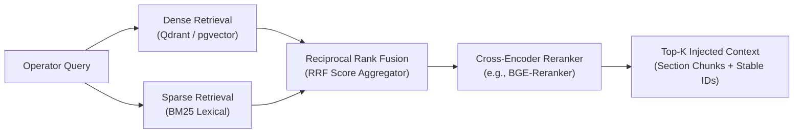
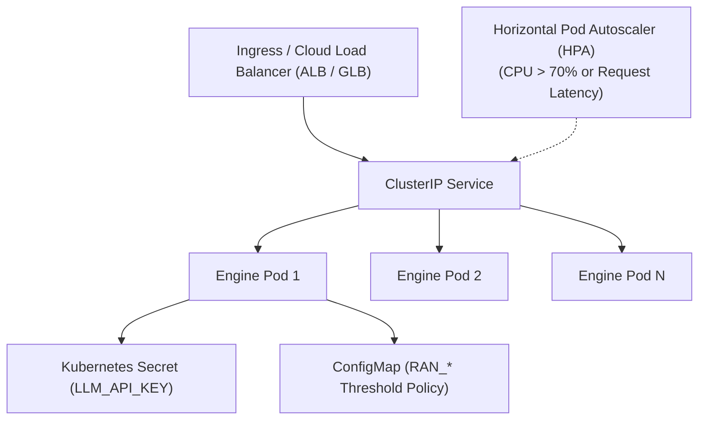

# Production & Cloud Architecture: High Concurrency Telco AI

This document details the production engineering and cloud architecture for scaling
`hacom-ai-telco-engine` in highly concurrent carrier-grade environments (AWS / GCP / K8s).

---

## 1. High Concurrency Backend Design (FastAPI & Async I/O)

In high-density mobile networks, thousands of cell KPI snapshots arrive per reporting window (e.g. 15-minute granularity). The backend is architected to sustain high throughput with sub-50ms latency for deterministic passes:

* **Pure In-Memory Domain Evaluation:** `diagnose()` functions are completely pure (zero database roundtrips, zero disk I/O, zero network calls). CPU bound calculations run natively within sub-millisecond execution times.
* **Non-Blocking Asynchronous Tool Invocation:** Where external calls are required (LLM providers or distributed vector search), the agent uses non-blocking asynchronous clients (`httpx.AsyncClient` with pooled HTTP/2 keep-alive connections).
* **Process Worker Model:** In containerized deployments, Uvicorn runs under Gunicorn with `uvloop` workers, with worker count scaled proportionally to available CPU cores (`(2 x cores) + 1`).

---

## 2. Vector Database Integration (pgvector / Qdrant) & Hybrid RAG

While lexical BM25 is the default for deterministic offline verification, carrier-grade production deployments transition to **Hybrid Search** across dense and sparse indexes:



### Architectural Mapping for Vector DBs:
* **`pgvector` (PostgreSQL):** Ideal for unified transactional + vector storage. Cell topology, historical KPI snapshots, and runbook embeddings coexist with ACID guarantees.
* **`Qdrant`:** Selected for high-scale, distributed vector search with HNSW indexes and payload filtering (e.g., filtering strictly by 3GPP release, vendor equipment, or frequency band).
* **Token Optimization & Latency Control:**
  * Chunking is strictly section-level (`## heading`), discarding conversational boilerplate and metadata bloat.
  * Context injection is capped at top-3 chunks (~600 tokens), preventing context-window dilution and slashing inference latency by ~70%.

---

## 3. Observability, Traceability & MLOps

Production LLM workflows require strict observability to eliminate silent failures, hallucinated telemetry, and latency degradation:

1. **Step-Level Execution Traces (`TraceStep`):**
   * Every invocation records exact tool calls, arguments, serialized summaries, and execution latency in milliseconds (`latency_ms`).
   * Trace data is returned in the API response and can be exported directly to OpenTelemetry collectors (Jaeger / Datadog).
2. **Schema Validation & Guardrails:**
   * Pydantic v2 enforces strict input validation. Out-of-bounds telemetry (e.g., negative bandwidth, PRB > 100%) fails immediately with `422 Unprocessable Entity` before reaching any model.
   * Telemetry is read-only for the agent (`diagnose_cell` accepts no arguments), rendering telemetry hallucination architecturally impossible.
3. **Metrics Export:**
   * Prometheus metrics track rule trigger frequencies, average latency per diagnostic rule, cache hit rates for runbooks, and token consumption per provider turn.

---

## 4. Kubernetes Deployment Topology (AWS EKS / GCP GKE)

The engine is packaged as a cloud-native microservice with horizontal auto-scaling:



### Reference Kubernetes Manifests:

```yaml
apiVersion: apps/v1
kind: Deployment
metadata:
  name: hacom-ai-telco-engine
  labels:
    app.kubernetes.io/name: hacom-ai-telco-engine
spec:
  replicas: 3
  selector:
    matchLabels:
      app.kubernetes.io/name: hacom-ai-telco-engine
  template:
    metadata:
      labels:
        app.kubernetes.io/name: hacom-ai-telco-engine
    spec:
      containers:
        - name: api
          image: hacom-ai-telco-engine:0.2.0
          imagePullPolicy: IfNotPresent
          ports:
            - containerPort: 8000
          envFrom:
            - configMapRef:
                name: ran-policy-thresholds
            - secretRef:
                name: llm-provider-credentials
          resources:
            requests:
              cpu: "500m"
              memory: "512Mi"
            limits:
              cpu: "2000m"
              memory: "1536Mi"
          livenessProbe:
            httpGet:
              path: /health
              port: 8000
            initialDelaySeconds: 5
            periodSeconds: 15
          readinessProbe:
            httpGet:
              path: /health
              port: 8000
            initialDelaySeconds: 3
            periodSeconds: 5
          securityContext:
            runAsNonRoot: true
            runAsUser: 10001
            readOnlyRootFilesystem: true
---
apiVersion: autoscaling/v2
kind: HorizontalPodAutoscaler
metadata:
  name: hacom-ai-telco-engine-hpa
spec:
  scaleTargetRef:
    apiVersion: apps/v1
    kind: Deployment
    name: hacom-ai-telco-engine
  minReplicas: 3
  maxReplicas: 20
  metrics:
    - type: Resource
      resource:
        name: cpu
        target:
          type: Utilization
          averageUtilization: 70
```
